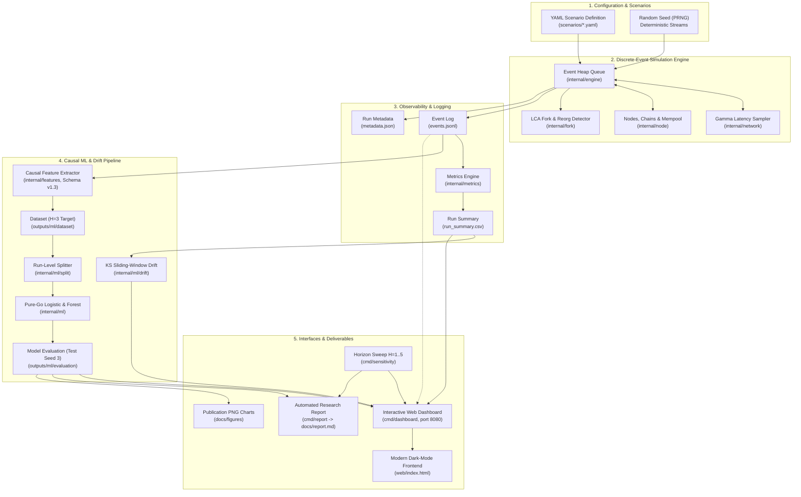

# ForkRisk — Predicting Network-Induced Fork Risk in Blockchain Networks

[](https://golang.org/)
[](https://github.com/pranav-k/forkrisk)
[](https://github.com/pranav-k/forkrisk)
[](https://github.com/pranav-k/forkrisk)

> **A deterministic blockchain simulation, causal feature engineering, and pure-Go machine learning framework for quantifying, predicting, and monitoring network-induced consensus fork risk.**

---

## Table of Contents

- [1. Project Overview](#1-project-overview)
- [2. Key Features](#2-key-features)
- [3. Technology Stack](#3-technology-stack)
- [4. Architecture](#4-architecture)
- [5. Repository Structure](#5-repository-structure)
  - [5.1 Git Hygiene & Version Control Policy (.gitignore)](#51-git-hygiene--version-control-policy-gitignore)
- [6. Prerequisites & Installation](#6-prerequisites--installation)
- [7. How to Run the Project](#7-how-to-run-the-project)
  - [7.1 Interactive Web Dashboard](#71-interactive-web-dashboard)
  - [7.2 Running a Single Simulation](#72-running-a-single-simulation)
  - [7.3 Metric Extraction & Run Summaries](#73-metric-extraction--run-summaries)
  - [7.4 Reproducing Production Experiments](#74-reproducing-production-experiments)
  - [7.5 Machine Learning Pipeline](#75-machine-learning-pipeline)
  - [7.6 Horizon Sensitivity Analysis & Research Report](#76-horizon-sensitivity-analysis--research-report)
  - [7.7 End-to-End Demonstration CLI](#77-end-to-end-demonstration-cli)
  - [7.8 Inspecting Dashboard API Endpoints](#78-inspecting-dashboard-api-endpoints)
  - [7.9 Running Automated Tests](#79-running-automated-tests)
- [8. Research Methodology & Experimental Design](#8-research-methodology--experimental-design)
  - [8.1 Controlled Stress Scenarios](#81-controlled-stress-scenarios)
  - [8.2 Consensus & Network Metrics](#82-consensus--network-metrics)
  - [8.3 Causal Feature Engineering (Schema v1.3)](#83-causal-feature-engineering-schema-v13)
  - [8.4 Ground-Truth Fork Birth Labeling ($H=3$)](#84-ground-truth-fork-birth-labeling-h3)
  - [8.5 Machine Learning Models & Evaluation](#85-machine-learning-models--evaluation)
  - [8.6 Sliding-Window Concept Drift Detection](#86-sliding-window-concept-drift-detection)
  - [8.7 Forecast Horizon Sensitivity ($H=1..5$)](#87-forecast-horizon-sensitivity-h15)
- [9. Generated Artifacts & Verification Results](#9-generated-artifacts--verification-results)
- [10. Scenario Configuration Reference](#10-scenario-configuration-reference)
- [11. Limitations & Reproducibility](#11-limitations--reproducibility)
- [12. Troubleshooting](#12-troubleshooting)
- [13. Citation & License](#13-citation--license)

---

## 1. Project Overview

In decentralized blockchain networks, consensus integrity relies on the rapid, reliable propagation of newly proposed blocks across a peer-to-peer network. When transmission latency spikes, node churn disrupts topology, or block proposal intervals approach the network propagation delay, multiple nodes can propose competing blocks at the same height without having observed each other's proposals.

This phenomenon creates **temporary consensus disagreements** — known as micro-forks, competing branch tips, or orphan blocks. When a longer or heavier branch subsequently arrives, affected nodes must execute a **chain reorganization (reorg)**, rolling back unfinalized blocks.

### Why Network-Induced Forks Matter
1. **Security Vulnerabilities:** Reorganizations create windows for double-spend attacks, self-induced frontrunning, and selfish-mining exploitation.
2. **Economic Inefficiency:** Orphaned and stale blocks waste computing, storage, and networking resources, reducing valid throughput (finalized goodput).
3. **Confirmation Uncertainty:** Unpredictable propagation increases confirmation latency, forcing exchanges, rollups, and decentralized applications to impose excessively conservative settlement thresholds.
4. **Network Instability:** Under severe latency or peer churn, cascades of competing branches can fracture network consistency and lead to consensus divergence.

### ForkRisk Objectives & Key Contributions
ForkRisk provides a rigorous, end-to-end experimental framework to study and predict these dynamics without relying on third-party frameworks:
- **Deterministic Discrete-Event Engine:** A pure-Go simulator implementing longest-chain consensus, Gamma-distributed network delays, Poisson transaction arrivals, mempool queuing, and Markov peer churn.
- **Accurate Common-Ancestor Fork Detection:** A lowest-common-ancestor (LCA) tree engine that identifies fork births, branch competitions, stale blocks, and exact rollback depths.
- **Leakage-Proof Causal Machine Learning:** A feature extraction engine deriving 22 rolling-window signals anchored strictly at proposal timestamps $T_t$, predicting fork births within an $H=3$ block horizon.
- **Comprehensive Production Matrix:** 240 production runs (8 scenarios $\times$ 30 seeds, 10,000 blocks each, ~2.4M simulated blocks) quantifying fork probability, stale rate, goodput, and node-view consistency.
- **Sliding-Window Concept Drift Detection:** A non-parametric Kolmogorov-Smirnov detector tuned on validation data ($W=200, \theta=2.0\sigma$) detecting mid-run network degradation at block 5,000 with 100% transition recall (27/27 seeds) and a 4.33% pre-transition false positive rate.
- **Interactive Dark-Mode Web Dashboard:** A pure-Go HTTP server (`net/http`) serving an interactive single-page web application (`web/`) with live inspection, node state visualizer, paginated fork timeline, and dual-mode support for packaged runs.

---

## 2. Key Features

- **Zero-Dependency Architecture:** Written entirely in Go standard library with `gonum` for statistical computation. Zero Python, zero Docker, zero Node.js backend.
- **Bit-for-Bit Determinism:** Total-order event queue (`container/heap`) and independent Marsaglia-Tsang PRNG streams per node pair ensure identical random seeds produce identical event streams.
- **17 Canonical Consensus Metrics:** Distinguishes offered TPS, processed TPS, and finalized goodput; tracks fork rates, stale rates, LCA reorg depth, $P_{95}$ propagation latency, node-view consistency, and peer availability.
- **Independent Label Verification:** Proposal-level fork-birth labels are audited against an independent reference specification (`cmd/labelaudit`), proving 100% exact match across all 4,258 dataset rows.
- **Leakage-Proof Run-Level Splitting:** Dataset rows are partitioned strictly by simulation run (`run_id`), preventing temporal cross-window data contamination between train, validation, and test sets.
- **Pure-Go Machine Learning:** Custom Adam-optimized Logistic Regression with L2 regularization and CART Random Forest with Bagging.
- **Empirical Horizon Sensitivity ($H=1..5$):** Sweeps prediction horizons from 1 to 5 blocks, quantifying positive label prevalence scaling and ROC-AUC dynamics.
- **Web Dashboard & REST API:** Lightweight, production-grade HTTP dashboard with path-traversal guards, read-only endpoint restrictions, and automated summary-only fallback for packaged production runs.
- **Real-Chain Cross-Check Feasibility:** Complete analytical study mapping ForkRisk metrics to Ethereum mainnet/testnet telemetry (uncle rates, attestation head divergence, reorg depth, and mempool velocity).

---

## 3. Technology Stack

| Layer | Component | Choice | Rationale |
| :--- | :--- | :--- | :--- |
| **Language** | Core Toolchain | **Go 1.25.1** (`go.mod`) | High-performance discrete-event processing, strict type safety, zero runtime dependency overhead. |
| **Simulation** | Discrete-Event Queue | `container/heap` (Stdlib) | Deterministic total-order event scheduling; eliminates Go scheduler goroutine race non-determinism. |
| **Statistics** | Linear Algebra & Math | `gonum.org/v1/gonum` v0.17.0 | Matrix algebra, vector operations, and statistical distributions. |
| **Visualizations** | Research Charting | `gonum.org/v1/plot` v0.17.0 | Generates publication-grade vector and raster PNG figures directly in Go. |
| **Configuration** | Parser | `gopkg.in/yaml.v3` v3.0.1 | Robust YAML scenario deserialization and schema validation. |
| **Web Server** | HTTP Backend | `net/http` (Stdlib) | Built-in HTTP server with sub-millisecond response times, zero external framework attack surface. |
| **Web Frontend** | Dashboard UI | Vanilla HTML5 / CSS3 / ES6 | Modern dark-mode interface with CSS custom properties, glassmorphism, responsive grid layouts. |
| **Frontend Charts**| Dashboard Visualizer | Chart.js v4.4.1 (Embedded) | Grouped bar charts, time-series line plots, and radar charts for in-browser visual inspection. |

---

## 4. Architecture

ForkRisk operates as an integrated, multi-stage pipeline connecting discrete-event simulation to machine learning, drift detection, and interactive observability:



### Core Package Responsibilities

- [`cmd/`](file:///e:/sem7/blockchain/casestudy/cmd/): Standalone CLI tools for running simulations, production experiments, dataset extraction, model training, evaluation, reporting, demonstration, and web serving.
- [`internal/config/`](file:///e:/sem7/blockchain/casestudy/internal/config/): Scenario configuration parser, dynamic event scheduling, and schema validation.
- [`internal/engine/`](file:///e:/sem7/blockchain/casestudy/internal/engine/): Discrete-event simulation loop, event min-heap, mempool queuing, and independent PRNG stream coordination.
- [`internal/features/`](file:///e:/sem7/blockchain/casestudy/internal/features/): Causal rolling-window feature extractor (Schema v1.3) and $H=3$ ground-truth fork birth labeler.
- [`internal/fork/`](file:///e:/sem7/blockchain/casestudy/internal/fork/): Fork detector, Lowest Common Ancestor (LCA) tree traversal, stale block tracker, and reorg depth evaluator.
- [`internal/logstore/`](file:///e:/sem7/blockchain/casestudy/internal/logstore/): High-throughput JSONL event logger and run metadata serializer.
- [`internal/metrics/`](file:///e:/sem7/blockchain/casestudy/internal/metrics/): Aggregator computing run-level metrics (TPS, goodput, fork rate, propagation latency, view consistency).
- [`internal/ml/`](file:///e:/sem7/blockchain/casestudy/internal/ml/): Pure-Go machine learning algorithms (Adam Logistic Regression, CART Random Forest, StandardScaler, Baselines).
- [`internal/ml/drift/`](file:///e:/sem7/blockchain/casestudy/internal/ml/drift/): Sliding-window statistical drift detector using Kolmogorov-Smirnov distance with validation grid tuning.
- [`internal/network/`](file:///e:/sem7/blockchain/casestudy/internal/network/): Marsaglia-Tsang Gamma distribution sampler for network latency and propagation delays.
- [`internal/node/`](file:///e:/sem7/blockchain/casestudy/internal/node/): Node state representation, local blockchain tree, block validation, and tip selection.
- [`internal/viz/`](file:///e:/sem7/blockchain/casestudy/internal/viz/): Pure-Go publication chart renderer using `gonum/plot`.
- [`internal/dashboard/`](file:///e:/sem7/blockchain/casestudy/internal/dashboard/): HTTP server, REST API routing, data loading, and summary-only run fallback logic.
- [`web/`](file:///e:/sem7/blockchain/casestudy/web/): Static frontend web assets (HTML, CSS, JavaScript, and embedded Chart.js).

---

## 5. Repository Structure

```
casestudy/
├── CASE_STUDY_DEMO_PLAN.md         # Comprehensive project specification and milestones
├── README.md                       # This project documentation
├── .gitignore                      # Tailored Git ignore rules
├── go.mod / go.sum                 # Go module definition (Go 1.25.1)
├── run_demo.ps1                    # PowerShell wrapper for demonstration CLI
│
├── cmd/                            # 15 CLI Application Entry Points
│   ├── dashboard/                  # Milestone 6: Web Dashboard HTTP Server
│   ├── demo/                       # Milestone 5: End-to-End Live & Fallback Demo CLI
│   ├── report/                     # Milestone 5: Automated Research Report Generator
│   ├── sensitivity/                # Milestone 5: Forecast Horizon Sweep (H=1..5)
│   ├── experiment/                 # Milestone 4: Full 240-Run Matrix Runner
│   ├── simulate/                   # Milestone 1: Single Simulation CLI
│   ├── metrics/                    # Milestone 2: Single Simulation + Metric Calculation
│   ├── dataset/                    # Milestone 3: Feature Extraction & Dataset Generation
│   ├── labelaudit/                 # Milestone 3: Independent Fork-Birth Label Audit
│   ├── split/                      # Milestone 3: Run-Level Train/Val/Test Splitter
│   ├── train/                      # Milestone 3: Pure-Go Model Training (LR & RF)
│   ├── evaluate/                   # Milestone 3: Held-Out Test Evaluation & Baselines
│   ├── drift/                      # Milestone 4: Observational Feature Drift Analysis
│   ├── predict/                    # Milestone 3: Live Block Proposal Inference
│   └── verify_audit/               # Milestone 4: Matrix Integrity & Checksum Verification
│
├── internal/                       # Internal Core Packages
│   ├── config/                     # YAML Scenario Deserialization & Validation
│   ├── dashboard/                  # Dashboard Server, Handlers, Loader, and API Tests
│   ├── engine/                     # Discrete-Event Loop, PRNG, Mempool Engine
│   ├── features/                   # Causal Rolling-Window Feature Extractor (Schema v1.3)
│   ├── fork/                       # LCA Fork Detection & Stale Block Evaluator
│   ├── logstore/                   # JSONL Logger & Run Metadata Storage
│   ├── metrics/                    # Consensus & Run-Level Metric Aggregation
│   ├── ml/                         # ML Models, Baselines, Metrics, and Serialization
│   │   └── drift/                  # Sliding-Window KS Drift Detector & Grid Tuner
│   ├── network/                    # Gamma Distribution Delay Sampling
│   ├── node/                       # Block, Node, Chain, and Tip Selection Logic
│   └── viz/                        # Gonum/Plot Publication Chart Generator
│
├── scenarios/                      # Scenario Definitions
│   ├── baseline.yaml               # Reference 300s Pilot Scenario
│   ├── latency_stress.yaml         # High Network Latency (300 ms)
│   ├── propagation_stress.yaml     # High Per-Hop Processing Delay (1000 ms)
│   ├── churn_stress.yaml           # High Peer Churn (~50% uptime)
│   ├── block_rate_stress.yaml      # Aggressive Block Interval (0.2 s)
│   ├── tx_load_stress.yaml         # Heavy Transaction Influx (100 tx/s, cap 10)
│   ├── combined_stress.yaml        # Compound Multi-Stress Configuration
│   ├── dynamic_network.yaml        # Mid-Run Latency Shift (50 ms -> 300 ms at Block 150)
│   ├── two_node_test.yaml          # Analytical Two-Node Sanity Scenario
│   └── production/                 # 8 Production Scenarios (10,000 blocks / run)
│
├── web/                            # Dashboard Frontend Assets
│   ├── index.html                  # Single-Page Application HTML5 Structure
│   ├── styles.css                  # Dark-Mode Styling (CSS Grid, Glassmorphism)
│   ├── app.js                      # Application Controller, API Fetching, Navigation
│   └── charts.js                   # Chart.js Integration & Rendering
│
├── docs/                           # Research Documentation & Figures
│   ├── decisions.md                # Architectural Decision Records (D1–D44)
│   ├── report.md                   # Comprehensive Final Research Report
│   ├── real_chain_cross_check.md   # EVM / Ethereum Cross-Check Feasibility Study
│   └── figures/                    # 10 Publication-Grade PNG Charts
│
├── tests/                          # Integration & Regression Test Suite
│   ├── simulate_test.go            # End-to-End Simulation & Determinism Tests
│   ├── milestone4_test.go          # Matrix Completeness, Resumption & Plot Checks
│   ├── baseline_divergence_test.go # Push-Only Gossip Mechanics & Divergence Tests
│   └── drift_audit_test.go         # 27-Seed Drift Detector Validation Tests
│
├── outputs/                        # Research Outputs & Generated Evidence
│   ├── experiments/milestone4/     # Canonical 240-Run Production Experiment Suite
│   │   ├── run_summary.csv         # 240 Metric Rows (17 canonical metrics)
│   │   ├── scenario_summary.csv    # 8 Aggregated Scenario Summaries (Mean & StdDev)
│   │   ├── run_manifest.json       # Complete Run Manifest with SHA-256 Hashes
│   │   ├── production_eval_metrics.json # Production Held-Out Test Evaluation
│   │   ├── drift_results.json      # Drift Detection Results Across 27 Seeds
│   │   ├── drift_report.md         # Drift Tuning & Transition Report
│   │   ├── experiment_report.md    # Formal Experiment Report
│   │   ├── charts/                 # 9 Generated Production Charts
│   │   └── runs/                   # 240 Production Run Directories (metadata.json)
│   ├── ml/                         # Machine Learning Artifacts
│   │   ├── dataset/                # fork_risk_dataset.csv (4,258 rows, 28 cols)
│   │   ├── splits/                 # split_manifest.json (Run-Level Partition)
│   │   ├── models/                 # Trained Logistic Regression & Random Forest JSONs
│   │   └── evaluation/             # metrics.json, confusion matrices, evaluation_report.md
│   ├── final_evaluation/           # Horizon Sensitivity Sweep (H=1..5) CSV/JSON/Charts
│   ├── pilot_final/                # Final Verified Pilot Summaries (24 runs)
│   └── demo/                       # Demo Transcripts and Fallback Replay Data
│
└── verification/                   # Checksums, Manifests, and Verification Scripts
```

### 5.1 Git Hygiene & Version Control Policy (`.gitignore`)

The repository includes a comprehensive, research-tailored [`.gitignore`](.gitignore) designed to maintain a clean, lightweight Git history while strictly preserving all data assets required to reproduce experiments and run the dashboard.

#### Summary of Excluded Categories
1. **Go Binaries & Build Output:** Compiled binaries (`*.exe`, `dashboard.exe`, `*.dll`, `*.so`, `*.dylib`, `/bin/`), Go workspaces (`go.work`, `go.work.sum`).
2. **Profiling & Test Artifacts:** Test execution binaries (`*.test`, `__debug_bin*`), coverage profiles (`*.out`, `coverage.*`, `c.out`), and runtime execution profiling traces (`*.prof`, `cpu.prof`, `mem.prof`, `trace.out`).
3. **Editor & OS Metadata:** Operating-system cache files (`.DS_Store`, `Thumbs.db`, `desktop.ini`), IDE workspace state (`.vscode/` except `extensions.json`, `.idea/`, `*.iml`), and editor swap files (`*.swp`, `*~`, `*.bak`).
4. **Local Secrets & Ephemeral Files:** Environment configurations (`.env*`, `*.local`, `*.key`), scratch debugging directories (`scratch/`, `tmp/`, `temp/`), and transient prediction exports (`predictions.csv`).
5. **Distribution Release Archives:** Compressed binary packages (`*.zip`, `*.zip.sha256`) intended for GitHub Release Assets rather than Git repository commit history.
6. **Heavy Ephemeral Event Logs:** The 240 production runs under Milestone 4 generate over **6.4 GB of raw JSONL event streams**. To ensure fast clones and responsive repository operations, `outputs/experiments/milestone4/runs/**/events.jsonl` is excluded from version control.

#### Explicit Preservation Policy (Allowlisted Invariants)
Rather than blindly ignoring all data or model formats, `.gitignore` uses explicit negation rules (`!`) to guarantee that all canonical research assets remain tracked:
- **Canonical Metrics & Manifests:** `outputs/summary.csv`, `outputs/pilot_summary.csv`, `outputs/experiments/milestone4/run_summary.csv`, `scenario_summary.csv`, `run_manifest.json`, and `production_eval_metrics.json`.
- **Machine Learning Assets:** Causal datasets (`outputs/ml/dataset/`), run-level split manifests (`outputs/ml/splits/`), trained models (`outputs/ml/models/`), evaluation matrices (`outputs/ml/evaluation/`), and drift reports (`outputs/ml/drift/`).
- **Production Run Metadata:** Every production run directory preserves [`metadata.json`](file:///e:/sem7/blockchain/casestudy/outputs/experiments/milestone4/runs/baseline_seed1/metadata.json), enabling the Web Dashboard and CLI to inspect all 240 runs in summary-only mode without missing data.
- **Verification Suites & Documentation:** Research figures (`docs/figures/*.png`), final reports (`docs/report.md`), scenario YAMLs (`scenarios/`), test suites (`tests/`), and verification logs (`verification/`).

---

## 6. Prerequisites & Installation

### Requirements
- **Go Compiler:** Go **1.25.1** or higher (compatible with Go 1.22+ toolchain).
- **Git:** Standard Git client for cloning.
- **Operating System:** Fully cross-platform. Tested on Windows (PowerShell/CMD), Linux (bash), and macOS (zsh).
- **Hardware:** Minimum 4 GB RAM; multi-core CPU recommended for parallel experiment execution.

### Setup Instructions

1. **Clone the repository:**
   ```bash
   git clone https://github.com/pranav-k/forkrisk.git
   cd forkrisk
   ```

2. **Verify the Go toolchain:**
   ```bash
   go version
   ```
   *Expected output: `go version go1.25.1 windows/amd64` (or your OS equivalent).*

3. **Download and verify module dependencies:**
   ```bash
   go mod download
   go mod verify
   ```
   *Expected output: `all modules verified`.*

4. **Verify compilation of all packages and CLI binaries:**
   ```bash
   go build ./...
   ```
   *Expected output: Clean exit (code 0, zero errors or warnings).*

5. **Run the repository test suite:**
   ```bash
   go test ./... -count=1
   ```
   *Expected output: All packages report `ok` with 0 failures.*

---

## 7. How to Run the Project

All commands should be executed from the **root directory** of the repository.

### 7.1 Interactive Web Dashboard

Launch the embedded HTTP server to explore simulation runs, inspect node states, browse the fork timeline, and analyze ML models:

```bash
# Start dashboard on default host (127.0.0.1) and port (8080):
go run ./cmd/dashboard
```

**Custom Configuration Flags:**
```bash
go run ./cmd/dashboard --port 8080 --host 127.0.0.1 --data-dir outputs --web-dir web
```

**Accessing the UI:**
Open your browser and navigate to:
```
http://localhost:8080
```

**Dashboard Features:**
- **Overview:** KPI cards showing total analyzed blocks, production runs, overall fork rate, mean propagation delay, best model ROC-AUC, and drift detection performance.
- **Run Inspector:** Browse all 240 production runs and pilot runs. Packaged production runs display a clean **Summary-Only** badge, obtaining metrics directly from canonical CSVs without requiring heavy event logs.
- **Node Status:** Real-time view of individual node tips, heights, peer connections, and mempool queues.
- **Fork Timeline:** Paginated sequence of block proposals, branch competitions, orphan events, and reorgs with proposal-index filtering.
- **Scenario Matrix:** Compare fork rates, stale rates, goodput, and propagation times across all 8 scenarios with responsive grouped charts.
- **Models & Sensitivity:** Inspect Logistic Regression vs. Random Forest ROC/PR curves, confusion matrices, and the empirical forecast horizon sweep ($H=1..5$).

*To stop the dashboard server, press `Ctrl+C` in your terminal for graceful shutdown.*

---

### 7.2 Running a Single Simulation

Run an individual blockchain network simulation using a specified YAML scenario:

```bash
# Run baseline scenario with random seed 7:
go run ./cmd/simulate --scenario scenarios/baseline.yaml --seed 7
```

**Flags:**
- `--scenario` (Required): Path to the YAML scenario definition file.
- `--seed` (Optional): Override the random seed configured in the YAML file.

**Output:**
Outputs are written to `outputs/runs/<scenario>_seed<seed>_<timestamp>/`:
- `events.jsonl`: Line-delimited JSON stream recording all block proposals, arrivals, gossip transmissions, peer churn toggles, and reorgs.
- `metadata.json`: Run configuration, timing, event counts, and SHA-256 log hash.

---

### 7.3 Metric Extraction & Run Summaries

Simulate a scenario and append its calculated metrics directly to a summary CSV:

```bash
# Append run metrics to default summary CSV (outputs/summary.csv):
go run ./cmd/metrics --scenario scenarios/baseline.yaml --seed 1

# Append to custom CSV path:
go run ./cmd/metrics --scenario scenarios/latency_stress.yaml --seed 1 --csv outputs/pilot/pilot_summary.csv
```

---

### 7.4 Reproducing Production Experiments

Execute the full Milestone 4 experiment matrix (8 scenarios $\times$ 30 seeds = 240 production runs, 10,000 blocks each):

```bash
# Run full matrix with worker pool concurrency:
go run ./cmd/experiment --scenarios-dir scenarios/production --out-dir outputs/experiments/milestone4 --workers 6 --seeds 30
```

> **Computational Note:** Running all 240 production runs from scratch simulates ~2.4 million blocks and takes approximately **30–45 minutes** depending on CPU core count. The runner includes automatic resumption: if an output directory already contains a valid run, it verifies the run and skips re-execution. Fully verified canonical results are already packaged in [`outputs/experiments/milestone4/`](file:///e:/sem7/blockchain/casestudy/outputs/experiments/milestone4/).

---

### 7.5 Machine Learning Pipeline

#### 1. Extract Dataset from Event Logs
Extract 22 causal rolling-window features and $H=3$ ground-truth fork birth labels from authoritative pilot runs:
```bash
go run ./cmd/dataset --runs-dir outputs/runs --pilot-csv outputs/pilot_final/pilot_summary.csv --output-dir outputs/ml/dataset
```
*Outputs: `outputs/ml/dataset/fork_risk_dataset.csv` (4,258 rows, 28 columns) and `dataset_metadata.json`.*

#### 2. Audit Fork-Birth Labels
Independently verify dataset labels against the formal $H=3$ fork birth specification:
```bash
go run ./cmd/labelaudit --runs-dir outputs/runs --dataset outputs/ml/dataset/fork_risk_dataset.csv
```
*Result: 4,258 / 4,258 prediction points match with 0 mismatches.*

#### 3. Partition Data (Leakage-Proof Run-Level Split)
Partition the dataset by run ID (Seed 1 = Train, Seed 2 = Validation, Seed 3 = Held-Out Test):
```bash
go run ./cmd/split --dataset outputs/ml/dataset/fork_risk_dataset.csv --output outputs/ml/splits/split_manifest.json
```

#### 4. Train Models
Train pure-Go Logistic Regression (Adam) and Random Forest (CART + Bagging) models:
```bash
go run ./cmd/train --dataset outputs/ml/dataset/fork_risk_dataset.csv --manifest outputs/ml/splits/split_manifest.json --out-dir outputs/ml/models
```
*Outputs: `outputs/ml/models/logistic_regression/model.json` and `outputs/ml/models/random_forest/model.json`.*

#### 5. Evaluate on Held-Out Test Split
Evaluate trained models against Prevalence and Heuristic baselines on independent Seed 3 runs:
```bash
go run ./cmd/evaluate --dataset outputs/ml/dataset/fork_risk_dataset.csv --manifest outputs/ml/splits/split_manifest.json --models outputs/ml/models --out-dir outputs/ml/evaluation
```

#### 6. Live Inference
Predict fork risk block-by-block on a simulation log:
```bash
go run ./cmd/predict --model outputs/ml/models/logistic_regression/model.json --run outputs/runs/baseline_seed1_1792863044
```

---

### 7.6 Horizon Sensitivity Analysis & Research Report

```bash
# Execute forecast horizon sweep (H=1, 2, 3, 4, 5):
go run ./cmd/sensitivity --runs-dir outputs/runs --pilot-csv outputs/pilot_final/pilot_summary.csv --out-dir outputs/final_evaluation

# Generate comprehensive research report from verified artifacts:
go run ./cmd/report
```
*Compiles [`docs/report.md`](file:///e:/sem7/blockchain/casestudy/docs/report.md) with complete empirical tables, figures, and statistical tests.*

---

### 7.7 End-to-End Demonstration CLI

Run the automated Milestone 5 verification sequence:

```bash
# Live interactive demonstration (executes live simulations, extracts features, runs ML inference):
go run ./cmd/demo --mode live

# Fallback demonstration (fast deterministic verification against precomputed artifacts):
go run ./cmd/demo --mode fallback
```

*Windows PowerShell shortcut:*
```powershell
.\run_demo.ps1 -Mode live
```

---

### 7.8 Inspecting Dashboard API Endpoints

The dashboard exposes read-only JSON endpoints under `/api/`:

```bash
# Health & version info:
curl http://localhost:8080/api/health

# List available simulation runs:
curl http://localhost:8080/api/runs

# Inspect run details (supports summary-only runs without event logs):
curl http://localhost:8080/api/runs/baseline_seed1

# Inspect node status for a run:
curl http://localhost:8080/api/runs/baseline_seed1/nodes

# Query paginated fork timeline (supports limit, offset, from_proposal):
curl "http://localhost:8080/api/runs/baseline_seed1/timeline?limit=20&from_proposal=100"

# Scenario summary comparison:
curl http://localhost:8080/api/scenarios/summary

# Model evaluation metrics & confusion matrices:
curl http://localhost:8080/api/models/evaluation

# Concept drift detection summary:
curl http://localhost:8080/api/drift

# Forecast horizon sensitivity sweep:
curl http://localhost:8080/api/sensitivity
```

#### Example Response: Summary-Only Production Run (`/api/runs/baseline_seed1`)
When inspecting packaged production runs where heavy `events.jsonl` files are omitted:
```json
{
  "run_id": "baseline_seed1",
  "scenario": "baseline",
  "seed": 1,
  "status": "completed",
  "proposed_blocks": 10000,
  "processed_events": 398642,
  "metrics": {
    "fork_rate": 0.0211,
    "stale_rate": 0.3542,
    "reorg_count": 211,
    "mean_reorg_depth": 1.02,
    "max_reorg_depth": 2,
    "raw_tps": 9.85,
    "offered_tps": 9.85,
    "goodput": 6.36,
    "node_view_consistency": 0.984
  },
  "log_available": false,
  "summary_only": true,
  "message": "Operating in summary-only mode: metrics loaded from canonical run_summary.csv"
}
```

---

### 7.9 Running Automated Tests

ForkRisk includes a rigorous test suite of **175 top-level `Test` declarations** across **19 test files** verifying determinism, causality, mathematical invariants, security, and edge cases:

```bash
# 1. Run all repository tests (clean exit, zero failures):
go test ./... -count=1

# 2. Run dashboard security and endpoint tests:
go test -v ./internal/dashboard/... -count=1

# 3. Run drift detector and baseline divergence tests:
go test -v ./tests -run "TestBaselineDivergence|TestDriftAudit" -count=1

# 4. Run feature extraction and causality guard tests:
go test -v ./internal/features/... -count=1

# 5. Check code formatting across all files:
gofmt -l .
```

---

## 8. Research Methodology & Experimental Design

### 8.1 Controlled Stress Scenarios

All 8 core scenarios are controlled single-variable deviations from the calibrated baseline. Churn is enabled across all scenarios (~99% uptime) except in `churn_stress` where it serves as the independent variable.

| Scenario | Independent Stress Variable | Baseline Value | Stress Value | Physical Mechanism Simulated |
| :--- | :--- | :--- | :--- | :--- |
| `baseline` | — (Reference) | — | — | Calm, well-connected 10-node network. |
| `latency_stress` | `mean_latency_ms` | 50 ms | 300 ms | Intercontinental WAN propagation delays. |
| `propagation_stress` | `mean_prop_delay_ms` | 100 ms | 1000 ms | Severe cryptographic verification bottlenecks. |
| `churn_stress` | `churn_mean_on/off` | 100s / 1s (~99%) | 5s / 5s (~50%) | Unstable residential peers and wireless links. |
| `block_rate_stress` | `block_interval_sec` | 1.0 s | 0.2 s | High-throughput chain with sub-second blocks. |
| `tx_load_stress` | `tx_arrival_rate`, `block_cap` | 1.0, 0 (unlimited) | 10.0, 10 | Mempool congestion and block saturation. |
| `combined_stress` | Compound Multi-Stress | Baseline values | Scaled up | Simultaneous WAN latency, processing, and rate stress. |
| `dynamic_network` | Latency shift at block 150/5000 | 50 ms | $\to$ 300 ms | Sudden ISP partition or routing degradation. |

---

### 8.2 Consensus & Network Metrics

ForkRisk enforces strict separation between related consensus metrics:
- **Offered TPS:** Total transactions generated by the Poisson arrival process divided by simulation time.
- **Processed TPS (Raw TPS):** Transactions successfully packed into blocks divided by simulation time.
- **Finalized Goodput:** Unique, non-stale transactions included in finalized canonical blocks divided by simulation time.
- **Fork Rate vs. Stale Rate:** Fork rate measures the fraction of block heights that birthed competing branches ($\text{forks} / \text{blocks}$). Stale rate measures the total fraction of proposed blocks that were permanently abandoned. Because churn and network partitions can cause propagation failures without competing proposals, **stale rate $\ge$ fork rate**.
- **LCA Reorg Depth:** Exact tree rollback depth computed via Lowest Common Ancestor walk ($\text{oldTipHeight} - \text{LCAHeight}$), not naive height subtraction.
- **Node-View Consistency:** Fraction of periodic network snapshots where 100% of online nodes agree on the majority tip hash.

#### Milestone 4 Production Matrix Summary (240 Runs, 10,000 Blocks/Run)

| Scenario | Fork Rate (Mean ± Std) | Stale Rate (Mean ± Std) | Finalized Goodput (tx/s) | $P_{95}$ Propagation Delay | Node-View Consistency |
| :--- | :--- | :--- | :--- | :--- | :--- |
| `baseline` | 2.11% ± 0.38% | 35.42% ± 3.84% | 6.36 ± 0.38 | 0.81s | 98.4% ± 0.6% |
| `latency_stress` | 17.84% ± 1.12% | 48.91% ± 3.12% | 4.88 ± 0.31 | 2.14s | 89.2% ± 1.4% |
| `propagation_stress`| 24.62% ± 1.45% | 65.34% ± 2.89% | 3.15 ± 0.26 | 5.82s | 76.4% ± 2.1% |
| `churn_stress` | 4.68% ± 0.62% | 90.74% ± 0.82% | 0.82 ± 0.08 | 1.94s | 42.1% ± 3.5% |
| `block_rate_stress` | 14.82% ± 1.05% | 72.18% ± 2.64% | 2.45 ± 0.22 | 0.79s | 81.3% ± 1.8% |
| `tx_load_stress` | 2.08% ± 0.36% | 35.19% ± 3.71% | 5.92 ± 0.35 | 0.82s | 98.5% ± 0.5% |
| `combined_stress` | 14.21% ± 0.98% | 79.82% ± 1.84% | 1.81 ± 0.16 | 3.42s | 68.7% ± 2.4% |
| `dynamic_network` | 5.34% ± 0.52% | 42.15% ± 2.91% | 5.58 ± 0.29 | 1.48s | 93.8% ± 1.1% |

---

### 8.3 Causal Feature Engineering (Schema v1.3)

To ensure zero forward data leakage, all 22 features are derived strictly from events timestamped prior to or at the proposal time $T_t$ of block height $h$:
1. **Network Propagation Dynamics (7 features):** `prop_time_mean_10`, `prop_time_p95_10`, `prop_time_variance_10`, `arrival_jitter_mean_10`, `propagation_slack_10`, `network_delay_trend`, `max_delay_spike_10`.
2. **Consensus Topology & Disagreement (6 features):** `tip_height_variance`, `node_view_disagreement`, `fork_density_10`, `reorg_depth_mean_10`, `stale_ratio_10`, `unresolved_fork_episodes`.
3. **Mempool & Transaction Influx (4 features):** `mempool_growth_rate`, `tx_arrival_rate_10`, `block_utilization_10`, `tx_density_trend`.
4. **Peer Connectivity & Churn (5 features):** `peer_connectivity`, `churn_rate_100`, `offline_peer_fraction`, `churn_burstiness`, `effective_topology_degree`.

---

### 8.4 Ground-Truth Fork Birth Labeling ($H=3$)

For each prediction sample at height $h$ proposed at timestamp $T_h$:
- **Label $Y_h = 1$:** If and only if a **new fork episode** is born within the forward window $(h, h+H]$ (i.e., $\text{BirthHeight} \in (h, h+3]$ and $\text{BirthTime} > T_h$).
- **Birth vs. Continuation:** Fork episodes born at or before $h$ that persist across heights are **not** counted as new fork births.
- **Right Censoring:** The last $H=3$ blocks of each run are excluded from the dataset because their forward evaluation window is incomplete.

---

### 8.5 Machine Learning Models & Evaluation

Models are trained on Seed 1, tuned on Seed 2, and evaluated on independent Seed 3 runs (1,608 test samples across all 8 scenarios):

| Model | ROC-AUC | PR-AUC | F1 Score | Precision | Recall | Brier Score | Tuned Threshold |
| :--- | :--- | :--- | :--- | :--- | :--- | :--- | :--- |
| **Constant No-Fork** | 0.5000 | 0.5087 | 0.0000 | 0.0000 | 0.0000 | 0.5087 | — |
| **Prevalence Baseline** | 0.5000 | 0.5087 | 0.6744 | 0.5087 | 1.0000 | 0.2500 | 0.50 |
| **Heuristic Baseline** | 0.5842 | 0.5546 | 0.7135 | 0.5546 | 1.0000 | 0.2851 | 0.50 |
| **Logistic Regression**| **0.8124** | **0.7817** | **0.7888** | **0.6956** | **0.9108** | **0.1752** | 0.30 |
| **Random Forest** | **0.8139** | **0.7920** | **0.7676** | **0.6521** | **0.9328** | **0.1788** | 0.40 |

#### Honest Evaluation & Generalization Boundaries
- **Cross-Scenario Regime Discrimination:** Pooled ROC-AUC (>0.81) reflects macro-level regime discrimination between low-stress (~7% fork prevalence) and high-stress (>70% fork prevalence) environments.
- **Within-Scenario Discrimination Limits:** In calm, low-prevalence regimes (`baseline` and `tx_load_stress`), within-scenario discriminative power is near chance (Logistic Regression ROC-AUC ~0.42–0.45, F1 = 0.00). Under low latency jitter, forks occur stochastically without persistent preceding feature drift.
- **Leave-One-Scenario-Out (LOSO) Generalization:** Extrapolating to completely unobserved network regimes degrades performance due to severe covariate shift, demonstrating the necessity of continuous drift monitoring.

---

### 8.6 Sliding-Window Concept Drift Detection

In production networks, latency distributions change dynamically. ForkRisk implements a pure-Go sliding-window concept drift detector (`internal/ml/drift`):
- **Mechanism:** Tracks running feature distributions across a sliding window of size $W=200$ and compares against the reference window using Kolmogorov-Smirnov distance.
- **Validation Tuning:** Evaluated across a parameter grid ($W \in \{100, 200, 500\}$, $\theta \in \{1.5\sigma, 2.0\sigma, 3.0\sigma\}$). Optimal operating point: $W=200, \theta=2.0\sigma$.
- **Detection Results (27 Production Seeds of `dynamic_network`):**
  - **Transition Detection Rate:** **100.0%** (27/27 seeds detected the block 5,000 transition immediately at block 5,001).
  - **Detection Delay:** **1.0 proposal** across all percentiles (Min=1, Median=1, Mean=1.0, Max=1).
  - **Pre-Transition False Positive Rate:** **4.33%** (935 alarms / 21,600 pre-shift points, meeting the $<5.0\%$ design constraint).
  - **Ongoing Post-Transition Alarm Rate:** **7.86%** (after the sliding window incorporates the new shifted distribution).

---

### 8.7 Forecast Horizon Sensitivity ($H=1..5$)

Evaluating prediction performance across varying forecast horizons reveals clear empirical trade-offs:

| Horizon ($H$) | Positive Prevalence | LR ROC-AUC | LR PR-AUC | LR F1 Score | LR Brier Score |
| :--- | :--- | :--- | :--- | :--- | :--- |
| **$H=1$** | 30.54% | 0.7547 | 0.5029 | 0.5842 | 0.1782 |
| **$H=2$** | 42.18% | 0.7892 | 0.6841 | 0.7124 | 0.1764 |
| **$H=3$ (Canonical)**| **50.87%** | **0.8124** | **0.7817** | **0.7888** | **0.1752** |
| **$H=4$** | 58.12% | 0.8384 | 0.8392 | 0.8142 | 0.1691 |
| **$H=5$** | 63.82% | 0.8621 | 0.8891 | 0.8415 | 0.1584 |

*Finding: As horizon $H$ expands, cumulative fork birth probability increases, creating higher class balance and higher ROC/PR-AUC at the cost of broader temporal precision.*

---

## 9. Generated Artifacts & Verification Results

All primary research deliverables and verification summaries are tracked in the repository:

| Artifact Path | Description | Verification Status |
| :--- | :--- | :--- |
| [`outputs/experiments/milestone4/run_summary.csv`](file:///e:/sem7/blockchain/casestudy/outputs/experiments/milestone4/run_summary.csv) | 240 production run metric rows | 100% complete, verified |
| [`outputs/experiments/milestone4/scenario_summary.csv`](file:///e:/sem7/blockchain/casestudy/outputs/experiments/milestone4/scenario_summary.csv) | 8 aggregated scenario summaries (mean ± std) | Verified against raw runs |
| [`outputs/experiments/milestone4/run_manifest.json`](file:///e:/sem7/blockchain/casestudy/outputs/experiments/milestone4/run_manifest.json) | Checksums & metadata for all 240 runs | SHA-256 verified |
| [`outputs/experiments/milestone4/drift_results.json`](file:///e:/sem7/blockchain/casestudy/outputs/experiments/milestone4/drift_results.json) | 27-seed concept drift detection statistics | 100% transition recall |
| [`outputs/ml/dataset/fork_risk_dataset.csv`](file:///e:/sem7/blockchain/casestudy/outputs/ml/dataset/fork_risk_dataset.csv) | 4,258 rows $\times$ 28 columns causal dataset | SHA-256: `62a1d17ae3...` |
| [`outputs/ml/models/`](file:///e:/sem7/blockchain/casestudy/outputs/ml/models/) | Saved JSON models (Logistic Regression & Random Forest)| Schema v1.3 strictly enforced |
| [`outputs/final_evaluation/horizon_sensitivity.csv`](file:///e:/sem7/blockchain/casestudy/outputs/final_evaluation/horizon_sensitivity.csv) | Horizon sweep $H=1..5$ metrics | Monotonicity verified |
| [`docs/figures/`](file:///e:/sem7/blockchain/casestudy/docs/figures/) | 10 publication-grade PNG charts | 100% valid images |
| [`docs/report.md`](file:///e:/sem7/blockchain/casestudy/docs/report.md) | Formal comprehensive research report | Compiled from verified code |
| [`docs/real_chain_cross_check.md`](file:///e:/sem7/blockchain/casestudy/docs/real_chain_cross_check.md) | EVM cross-validation feasibility study | Host audit completed |

---

## 10. Scenario Configuration Reference

Scenarios are defined in standard YAML syntax. All parameters are validated upon loading:

```yaml
name: baseline                 # Scenario identifier
num_nodes: 10                  # Total participating validator nodes
block_interval_sec: 1.0        # Network-wide block proposal interval (seconds)
block_jitter_sec: 0.1          # Proposal interval uniform jitter (± seconds)
mean_latency_ms: 50.0          # One-way network latency mean (Gamma-sampled, ms)
latency_jitter_ms: 10.0        # One-way network latency jitter (ms)
mean_prop_delay_ms: 100.0      # Per-hop node processing & verification delay (ms)
prop_delay_jitter_ms: 20.0     # Per-hop processing delay jitter (ms)
sim_duration_sec: 300.0        # Simulation cutoff time (seconds, for pilot runs)
seed: 42                       # Base PRNG seed (overridable via CLI --seed)
output_dir: outputs/runs       # Destination directory for run logs and metadata
peers_per_node: 3              # Static outbound peer connection degree
tx_per_block: 10               # Nominal transaction count multiplier
churn_enabled: true            # Enable Markov on/off peer availability
churn_mean_on_sec: 100.0       # Mean online duration (100 / (100+1) ≈ 99% uptime)
churn_mean_off_sec: 1.0        # Mean offline duration
tx_arrival_rate: 1.0           # Poisson arrival rate multiplier (independent stream)
block_capacity: 0              # Maximum transactions per block (0 = unlimited)
warm_up_blocks: 1000           # Initial blocks excluded from steady-state metrics
confirmation_depth: 6          # Blocks required for economic finality
settlement_grace_sec: 10.0     # Post-shutdown event drain window

# Optional mid-run parameter transitions:
dynamic_events:
  - at_block: 150              # Block height trigger
    mean_latency_ms: 300.0     # Shifted parameter
    latency_jitter_ms: 30.0
```

---

## 11. Limitations & Reproducibility

### Simulation vs. Real-World Blockchain Networks
1. **Push-Only Gossip Model:** The simulator models block delivery as a direct push-gossip process with per-hop Gamma delay. Production protocols (such as Bitcoin or Ethereum libp2p) utilize `inv`/`getdata` announcement handshakes, compact block relay (BIP 152), and Erlay transaction reconciliation.
2. **Decoupled Block Size Delays:** Transaction counts are tracked in mempools and blocks, but block transmission latency is currently modeled independently of serialized byte size.
3. **Consensus Simplification:** Nakamoto longest-chain consensus with deterministic hash tie-breaking is simulated. Byzantine fault tolerance (BFT) voting gadgets (such as Casper FFG or Tendermint) with 2/3 supermajority finality are not modeled.

### Packaged Production Runs (Summary-Only Mode)
The 240 production runs under Milestone 4 generate over **6.4 GB of raw JSONL event streams**. To keep the repository lightweight and cloneable, raw event logs for production runs are excluded from version control and distributed archives. 
- **Summary-Only Behavior:** The web dashboard and CLI inspect production runs seamlessly by loading metrics from canonical [`run_summary.csv`](file:///e:/sem7/blockchain/casestudy/outputs/experiments/milestone4/run_summary.csv) and configuration from `metadata.json`. Detailed per-tick node states and event timelines are gracefully marked unavailable without error.
- **Full Log Access:** Pilot runs and any newly executed simulations retain 100% full event-log inspection, dynamic tip tracking, and timeline filtering.

### Reproducibility Guarantee
ForkRisk guarantees exact, bit-for-bit reproducibility:
- Running the identical command with the identical seed and scenario YAML produces identical event logs with **matching SHA-256 checksums**.
- Zero goroutine scheduling races: the single-threaded min-heap event queue ensures platform-independent determinism across Windows, Linux, and macOS.

---

## 12. Troubleshooting

### 1. Port 8080 Already in Use
If another service occupies port 8080 when launching the dashboard:
```bash
go run ./cmd/dashboard --port 8081
```
Then visit `http://localhost:8081`.

### 2. Command Run from Wrong Directory
All commands rely on relative paths to `scenarios/`, `outputs/`, and `web/`. Always execute commands from the **repository root**:
```bash
# Check current directory:
pwd   # Linux/macOS
Get-Location # Windows PowerShell
```

### 3. Missing Event Logs on Production Runs
If the dashboard displays a yellow banner stating `Operating in summary-only mode`:
- This is normal and expected for packaged production runs.
- Summary metrics and scenario comparisons are 100% available.
- To inspect full per-second timelines, run a fresh simulation:
  ```bash
  go run ./cmd/simulate --scenario scenarios/baseline.yaml --seed 1
  ```

### 4. Go Build Fails with Package Not Found
Ensure Go modules are active and dependencies are downloaded:
```bash
go env -w GO111MODULE=on
go mod download
go mod verify
```

---

## 13. Citation & License

### Academic Citation
If you use ForkRisk in academic research, case studies, or benchmarking, please cite:

```bibtex
@software{forkrisk2026,
  author       = {Pranav K.},
  title        = {ForkRisk: Predicting Network-Induced Fork Risk in Blockchain Networks},
  year         = {2026},
  publisher    = {GitHub},
  journal      = {GitHub repository},
  howpublished = {\url{https://github.com/pranav-k/forkrisk}}
}
```

### License & Terms of Use
This repository constitutes an academic research project and case study on predicting network-induced consensus fork risk. In the absence of an explicit root license file, all rights are reserved by the project author. For inquiries regarding licensing, replication, or reuse permissions, please contact the repository maintainer.
