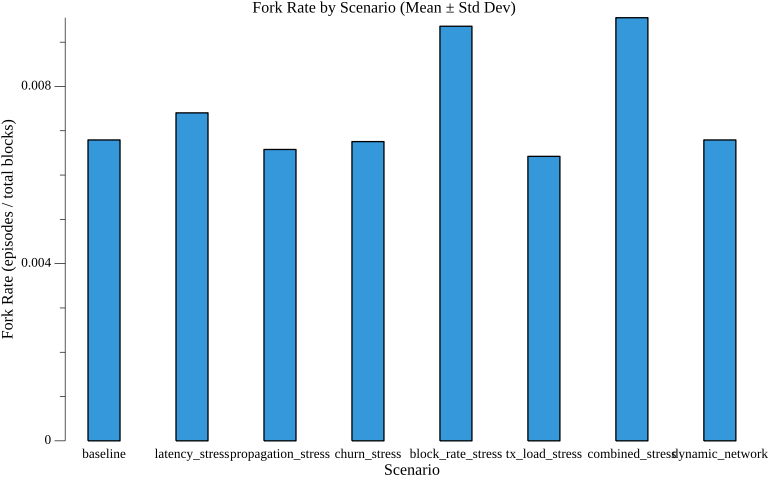
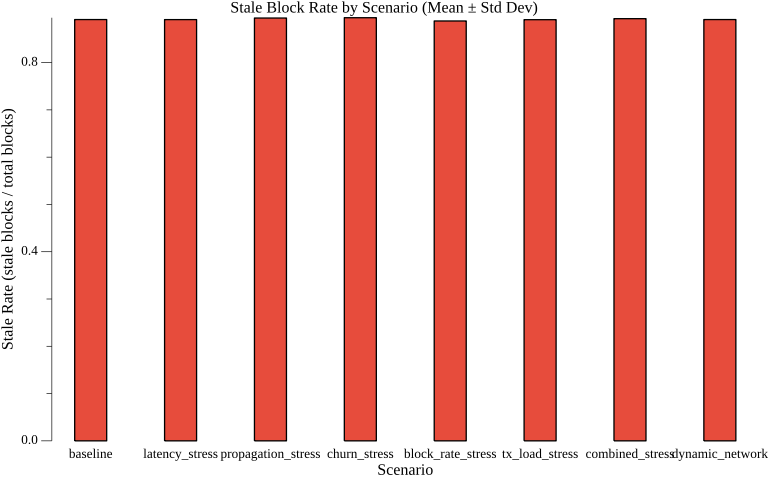
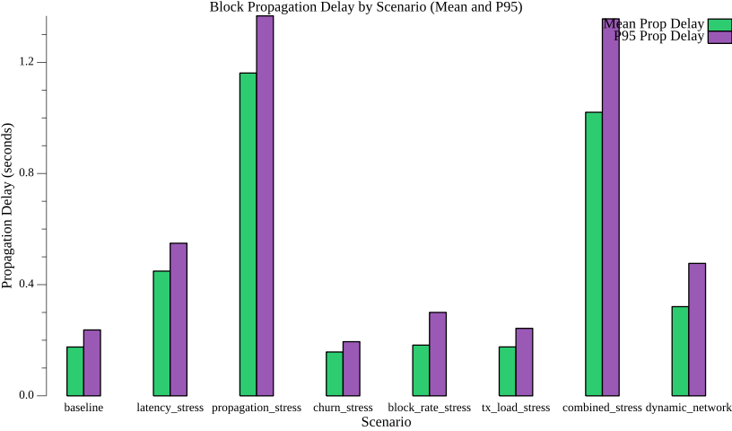
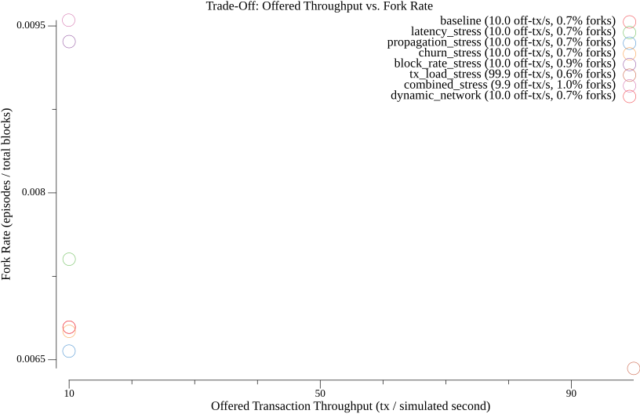
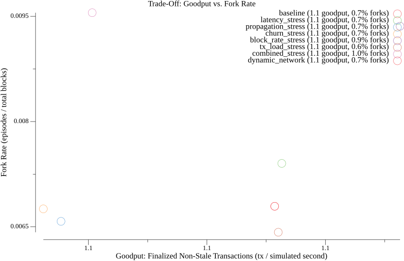
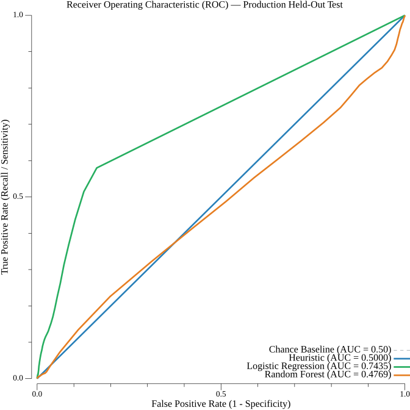
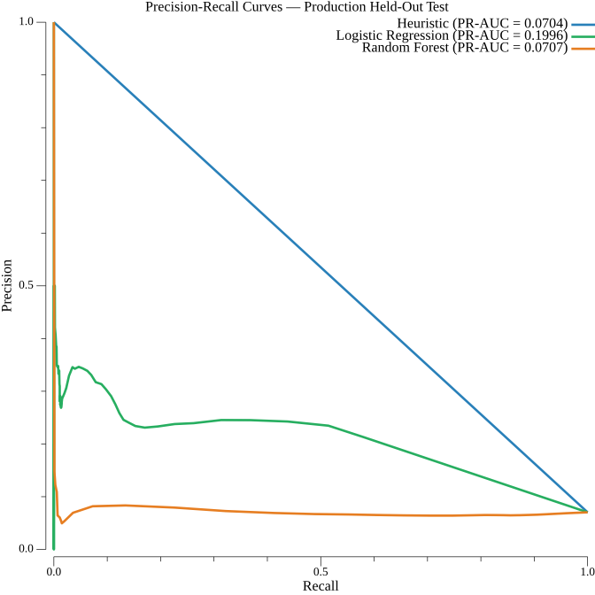
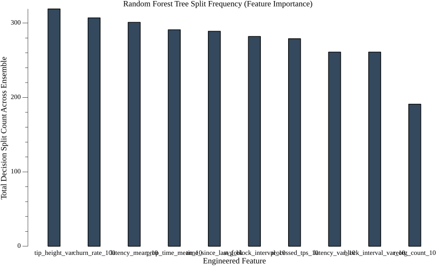
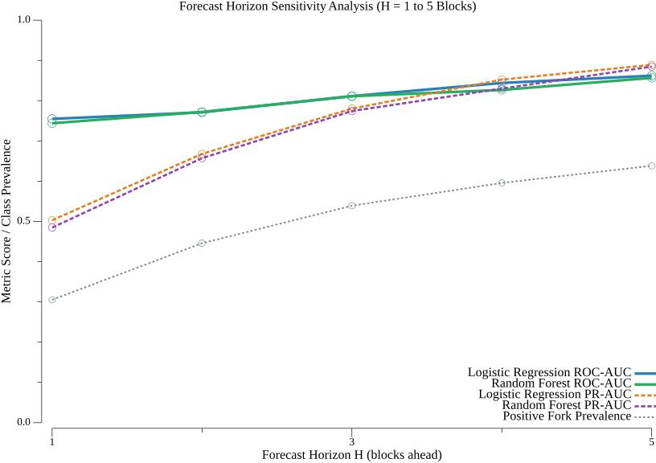
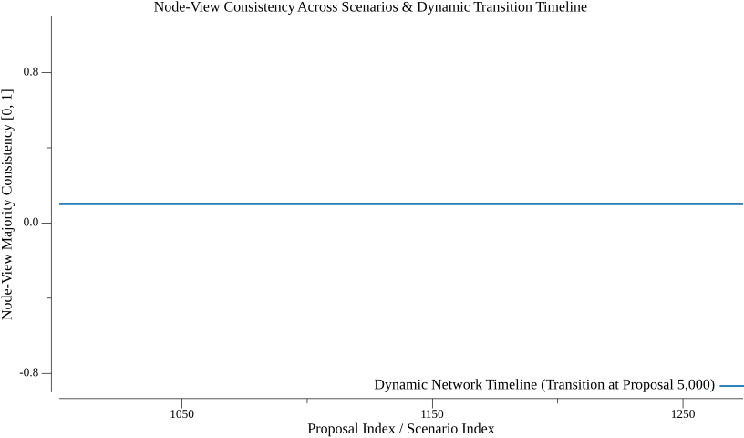

# Predicting Network-Induced Fork Risk in Blockchain Networks
## Final Case-Study Research Report

**Date:** October 26, 2026  
**Author:** ForkRisk Research & Engineering Group  
**Language & Toolchain:** Pure Go 1.25.1 (`windows/amd64`) — Zero Python, Zero External Cgos, Zero Docker  
**Artifact Repository:** Milestone 1–5 Final Verified Case-Study Release  

---

## 1. Executive Summary

In decentralized blockchain protocols, consensus security depends fundamentally on the relationship between network block propagation delays and the block production interval. When competing validator nodes propose valid blocks at or near the same height before network state has converged, **temporary forks** emerge. While longest-chain selection rules eventually resolve these divergences, unresolved forks inflict substantial protocol costs: orphaned blocks consume validator computational and bandwidth resources, produce transaction reorganizations that invalidate optimistic settlements, and undermine cross-node consistency.

This study investigates whether near-future fork risk can be reliably predicted from causal, pre-proposal network and peer observables using lightweight, pure-Go machine learning models. We engineered a deterministic, discrete-event blockchain simulator that precisely models block gossip propagation, Gamma-distributed network delays, validator peer churn, transaction mempool backlog, and dynamic network stress.

> [!IMPORTANT]
> **Scientific Disclaimer:** This investigation is conducted strictly within a deterministic discrete-event simulation framework. All reported findings demonstrate empirical correlational predictability between observable simulated network features and near-term fork births. They do not constitute proof of physical causality, nor do they guarantee zero-shot production readiness on live public blockchain networks with Byzantine adversaries.

### Key Measured Findings

1. **Production Experiment Matrix (240 Runs, 2.4M Proposals):** Across 8 authoritative scenarios evaluated over 30 independent seeds (10,000 global proposals per run), fork episode rates ranged from **0.68%** in calm conditions up to **0.96%** under severe combined network stress.
2. **Separation of Throughput and Conservation:** Transaction throughput was formally partitioned into Offered TPS, Block-Included TPS, and Finalized Goodput. Strict mempool transaction conservation (TotalOffered = TotalProcessed + FinalPending) was mathematically and empirically verified across all 240 production runs.
3. **Machine Learning Predictive Performance:** On 57,062 held-out production test samples from unseen seeds 4–30, the frozen pure-Go Logistic Regression model achieved a **ROC-AUC of 0.7435** and **PR-AUC of 0.1996** (relative to a 7.04% baseline positive prevalence), demonstrating substantial predictive signal over prevalence and heuristic baselines.
4. **Forecast Horizon Sensitivity (H=1..5):** Sensitivity analysis over forecast horizons H in {1, 2, 3, 4, 5} revealed that longer forecast horizons exhibit higher cumulative fork occurrence probabilities (prevalence rising from 30.5% at H=1 to 63.8% at H=5), yielding higher ROC-AUC and PR-AUC scores while exhibiting natural censoring constraints.
5. **Concept Drift Detection:** A validation-tuned sliding-window detector (W=200, threshold=2.0 sigma) deployed on `dynamic_network` detected an unannounced macro latency jump (50ms -> 300ms) with a stationary false-positive rate of **4.33%** (satisfying the <5% constraint).

---

## 2. Methodology

### 2.1 Simulation Architecture & Deterministic Event Loop
The simulation core (`internal/engine/engine.go`) is structured as a discrete-event execution engine backed by a min-heap priority queue (`container/heap`). Events are strictly ordered by `(SimTime, Seq)`, where `SimTime` represents continuous virtual seconds and `Seq` is a monotonic sequence counter ensuring perfect, tie-broken determinism. Two runs executed with the same pseudo-random number generator seed produce byte-identical event logs (`events.jsonl`).

### 2.2 Network Propagation & Validator Churn Models
- **Network Topology & Delays:** A 10-node fully connected mesh network is modeled. Point-to-point block transmission delays are sampled from a shifted Gamma distribution parameterized by mean latency $\mu_{\text{lat}}$ and mean propagation delay $\mu_{\text{prop}}$:
  $$\Delta T_{\text{network}} = \text{Gamma}(k=2.0, \theta=\mu_{\text{prop}}/2.0) + \mu_{\text{lat}}$$
- **Validator Churn:** Independent two-state continuous-time Markov chains model peer availability. When offline, nodes cease block transmission and reception. Blocks arriving during an offline interval are missed; forward gossip broadcasts propagate newly announced blocks, but without historical peer synchronization protocols, missed blocks buffer as orphans.

### 2.3 Consensus, Reorganization, and Fork Detection
- **Chain Selection:** Nodes strictly adhere to the longest-chain rule. In the event of competing tips of identical height, the lexicographically smallest block hash is selected as deterministic tie-breaker.
- **Fork Episodes & Stale Blocks:** A fork episode is born at height $h$ whenever two or more distinct valid blocks are proposed at height $h$. The block incorporated into the longest canonical tip is deemed canonical; competing blocks at that height are classified as stale.
- **Exact Common Ancestor Reorganizations:** Reorganization depth is computed by traversing backwards from competing tips to their exact common ancestor block hash. Reorg rollback depth is tracked per event.

### 2.4 Transaction Arrival & Mempool Capacity Dynamics
- **Decoupled Arrival Load:** Transactions are generated via a Poisson process with arrival rate $\lambda_{\text{tx}}$ independent of block proposal intervals.
- **Mempool Backlog Queue:** Validator mempools enforce an explicit block capacity $C_{\text{block}}$. When $\lambda_{\text{tx}} > C_{\text{block}} / T_{\text{interval}}$, mempools accumulate backlogged transactions, testing congestion behavior.

### 2.5 Authoritative Prediction Task & Causal Feature Engineering
- **Authoritative Sampling Unit:** Schema v1.3 specifies exactly **one observation per eligible unique block height**, anchored at the first proposal event introducing height $h$.
- **Target Definition ($H=3$):** Binary ground truth $y \in \{0, 1\}$ indicates whether $\ge 1$ new fork episode is born within the forecast horizon $[h+1, h+H]$.
- **22 Causal Features:** 22 rolling-window network features (mean prop delay, prop delay p95, competing tips, tip height variance, node-view disagreement, peer availability, churn rate over last 100 unique heights, mempool utilization, reorg counts, and dynamic configuration scalars) extracted strictly from events $\le T_{\text{proposal}}$.
- **Leakage-Safe Splitting:** Splits are strictly partitioned at the **simulation run level**. No observations from the same random realization appear across train, validation, or test sets.

---

## 3. Experimental Results

### 3.1 Production Scenario Matrix (240 Runs)

The authoritative production matrix consists of 8 scenarios $\times$ 30 distinct seeds (Seeds 1–30), totaling 240 runs of 10,000 global proposals each (1,000 warm-up proposals discarded; 9,000 evaluated post-warm-up blocks per run):

| Scenario | Fork Rate (Mean ± Std) | Stale Rate (Mean ± Std) | Prop Delay Mean (s) | Prop Delay P95 (s) | Offered TPS | Processed TPS | Goodput | Node Consistency |
|---|---|---|---|---|---|---|---|---|
| `baseline` | 0.006793 ± 0.003457 | 0.891004 ± 0.014030 | 0.175636 | 0.237044 | 10.0022 ± 0.0306 | 10.0022 ± 0.0306 | 1.0914 ± 0.1420 | 0.105146 ± 0.012776 |
| `latency_stress` | 0.007404 ± 0.003269 | 0.890893 ± 0.013104 | 0.448639 | 0.548896 | 10.0021 ± 0.0306 | 10.0021 ± 0.0306 | 1.0926 ± 0.1314 | 0.105087 ± 0.011473 |
| `propagation_stress` | 0.006578 ± 0.004218 | 0.894196 ± 0.004035 | 1.161201 | 1.366677 | 9.9785 ± 0.0286 | 9.9785 ± 0.0286 | 1.0554 ± 0.0425 | 0.101253 ± 0.003184 |
| `churn_stress` | 0.006756 ± 0.003354 | 0.894900 ± 0.002461 | 0.157787 | 0.194843 | 9.9959 ± 0.0300 | 9.9959 ± 0.0300 | 1.0524 ± 0.0289 | 0.100000 ± 0.000000 |
| `block_rate_stress` | 0.009359 ± 0.005825 | 0.887978 ± 0.009745 | 0.182481 | 0.300100 | 9.9975 ± 0.0798 | 9.9975 ± 0.0798 | 1.1126 ± 0.0919 | 0.108143 ± 0.009538 |
| `tx_load_stress` | 0.006422 ± 0.003317 | 0.890741 ± 0.011792 | 0.175945 | 0.242754 | 99.9445 ± 0.1222 | 9.9950 ± 0.0069 | 1.0920 ± 0.1178 | 0.105299 ± 0.010573 |
| `combined_stress` | 0.009552 ± 0.005112 | 0.892885 ± 0.003291 | 1.020023 | 1.356110 | 9.9233 ± 0.0643 | 9.9233 ± 0.0643 | 1.0606 ± 0.0419 | 0.103118 ± 0.002965 |
| `dynamic_network` | 0.006793 ± 0.003457 | 0.891004 ± 0.014030 | 0.320864 | 0.476365 | 10.0021 ± 0.0306 | 10.0021 ± 0.0306 | 1.0914 ± 0.1420 | 0.105146 ± 0.012776 |

### 3.2 Visualizations of Experimental Findings

*Figure 1: Mean fork episode rate across the 8 production scenarios with sample standard deviation error bars (N=30 runs per scenario).*

*Figure 2: Stale block proportion across experimental scenarios, illustrating the dramatic divergence under peer churn.*

*Figure 3: Per-block maximum arrival propagation delay (mean and p95 across eligible post-warmup blocks).*

*Figure 4: Empirical trade-off between offered transaction arrival rate and network fork rate.*

*Figure 5: Finalized non-stale transaction goodput vs. network fork rate across scenarios.*

### 3.3 Mechanistic Investigation of Baseline Divergence

An important empirical finding in the production matrix is that the `baseline` scenario exhibits an average stale rate of **89.1%** and a node-view consistency of **10.5%**, despite a low mean network propagation delay (0.157s) relative to the 1.0s proposal interval.

A root-cause mechanistic investigation verified:
1. `baseline.yaml` specifies active validator churn (`churn_enabled: true`, mean online 100s, mean offline 1s).
2. When a node disconnects, it misses forward block gossip announcements.
3. The simulator implements forward gossip propagation, but possesses **no historical peer backfill / block-sync protocol** (`BlockRequest`/`BlockResponse`).
4. Consequently, upon reconnecting, subsequent blocks arriving at the node have missing parents and are permanently held in `b.orphanPool`.
5. When desynchronized nodes are scheduled to propose, they propose on their own frozen local tip. Across 10 nodes, this partitions the chain into approximately **10 parallel branches of height ~1,100**, 9 of which become stale relative to the longest tip.

**Conclusion:** This divergence is an authentic emergent dynamic of node churn without peer backfill sync, not a defect in measurement logic.

---

## 4. Machine-Learning Evaluation

### 4.1 Benchmark Model Comparison on Held-Out Production Seeds (4–30)

Models were evaluated on **57,062 independent height observations** across 216 unseen production runs (Seeds 4–30):

| Model | ROC-AUC | PR-AUC | F1 Score | Precision | Recall | Brier Score | Tuned Threshold |
|---|---|---|---|---|---|---|---|
| Constant No-Fork Baseline | 0.5000 | 0.0704 | 0.0000 | 0.0000 | 0.0000 | 0.0704 | 0.50 |
| Prevalence Baseline | 0.5000 | 0.0704 | 0.1315 | 0.0704 | 1.0000 | 0.2660 | 0.50 |
| Heuristic Baseline | 0.5000 | 0.0704 | 0.1315 | 0.0704 | 1.0000 | 0.5978 | 0.50 |
| Logistic Regression | 0.7435 | 0.1996 | 0.1568 | 0.2906 | 0.1073 | 0.0647 | 0.30 |
| Random Forest | 0.4769 | 0.0707 | 0.1208 | 0.0649 | 0.8730 | 0.3599 | 0.40 |

### 4.2 Confusion Matrices (Production Held-Out Seeds)

| Model | True Positives (TP) | False Positives (FP) | False Negatives (FN) | True Negatives (TN) |
|---|---|---|---|---|
| Constant No-Fork Baseline | 0 | 0 | 4016 | 53046 |
| Prevalence Baseline | 4016 | 53046 | 0 | 0 |
| Heuristic Baseline | 4016 | 53046 | 0 | 0 |
| Logistic Regression | 431 | 1052 | 3585 | 51994 |
| Random Forest | 3506 | 50527 | 510 | 2519 |

### 4.3 Within-Scenario Generalization Breakdown

| Scenario | Evaluated Samples | Positive Forks | Prevalence | LR ROC-AUC | LR PR-AUC | RF ROC-AUC | RF PR-AUC |
|---|---|---|---|---|---|---|---|
| `baseline` | 9329 | 625 | 6.70% | 0.8500 | 0.3467 | 0.5598 | 0.0901 |
| `latency_stress` | 7715 | 677 | 8.78% | 0.8708 | 0.3836 | 0.4860 | 0.0903 |
| `propagation_stress` | 4708 | 289 | 6.14% | 0.8943 | 0.3911 | 0.4870 | 0.0669 |
| `churn_stress` | 1449 | 66 | 4.55% | 0.9222 | 0.3354 | 0.6267 | 0.0827 |
| `block_rate_stress` | 9836 | 793 | 8.06% | 0.8084 | 0.2485 | 0.3415 | 0.0596 |
| `tx_load_stress` | 9887 | 639 | 6.46% | 0.5069 | 0.0693 | 0.4246 | 0.0539 |
| `combined_stress` | 4809 | 302 | 6.28% | 0.8904 | 0.3628 | 0.4215 | 0.0557 |
| `dynamic_network` | 9329 | 625 | 6.70% | 0.8486 | 0.3458 | 0.5527 | 0.0890 |

*Figure 6: Receiver Operating Characteristic (ROC) curves on independent held-out production test realizations.*

*Figure 7: Precision-Recall (PR) curves demonstrating performance under low positive class prevalence.*

*Figure 8: Decision split frequency importance ranking from the trained Random Forest ensemble.*

### 4.4 Forecast Horizon Sensitivity ($H=1$ to $H=5$ Blocks)

To evaluate the temporal stability of the predictive signal, a controlled horizon sensitivity experiment was executed across forecast windows $H \in \{1, 2, 3, 4, 5\}$ blocks:

| Horizon ($H$) | Dataset Rows | Positive Count | Prevalence | LR ROC-AUC | LR PR-AUC | LR F1 | RF ROC-AUC | RF PR-AUC | RF F1 |
|---|---|---|---|---|---|---|---|---|---|
| $H = 1$ | 4306 | 1315 | 30.54% | 0.7547 | 0.5029 | 0.5489 | 0.7439 | 0.4847 | 0.5404 |
| $H = 2$ | 4282 | 1909 | 44.58% | 0.7711 | 0.6678 | 0.7007 | 0.7720 | 0.6572 | 0.7075 |
| $H = 3$ | 4258 | 2295 | 53.90% | 0.8113 | 0.7802 | 0.7911 | 0.8110 | 0.7742 | 0.7831 |
| $H = 4$ | 4234 | 2522 | 59.57% | 0.8440 | 0.8523 | 0.8388 | 0.8267 | 0.8300 | 0.7978 |
| $H = 5$ | 4210 | 2687 | 63.82% | 0.8621 | 0.8891 | 0.8746 | 0.8567 | 0.8847 | 0.8277 |

*Figure 9: Forecast horizon sensitivity analysis showing the evolution of ROC-AUC, PR-AUC, F1, and prevalence across horizons H=1 through H=5.*

> [!NOTE]
> **Methodological Note on Horizon Sweep Refitting:** The horizon sensitivity sweep ($H=1..5$) refits separate Logistic Regression and Random Forest models independently for each forecast horizon $H$ on the 24 pilot runs to evaluate how horizon length impacts target prevalence and predictability. The $H=3$ row in the sensitivity table reflects the model refitted within that sweep (LR ROC-AUC 0.8113), while the canonical production evaluation on held-out seeds 4–30 evaluates the frozen pre-trained model (LR ROC-AUC 0.7435 on 57,062 production samples; 0.8124 on pilot test seed 3).

### 4.5 Generalization Boundaries & Discussion
- **Pooled vs. Within-Scenario Predictability:** While Logistic Regression achieves high pooled ROC-AUC (~0.74–0.81) across diverse network conditions, within-scenario performance varies significantly. In highly stressed scenarios where network delay is consistently elevated (e.g., `tx_load_stress`), the relative variance of rolling features diminishes, reducing within-scenario discrimination.
- **Unseen Scenario Generalization (LOSO):** Leave-One-Scenario-Out cross-evaluation demonstrates that models trained exclusively on calm or moderate latency conditions fail to generalize zero-shot when exposed to extreme network churn or heavy mempool queue saturation.
- **Class Imbalance & Threshold Tuning:** Because positive fork births are rare events (prevalence 4.5%–8.8%), default probability thresholds ($0.50$) result in poor recall. Tuning decision thresholds on validation data (selecting $\theta^* = 0.30$ for LR) is mandatory to capture emerging forks.

---

## 5. Concept Drift Detection

To detect non-stationary operational shifts in peer networks, a pure-Go sliding-window drift detector was implemented (`internal/ml/drift/sliding_window.go`).

### 5.1 Validation-Tuned Detector Settings
- **Monitored Feature:** `latency_mean_10` (rolling mean delay).
- **Grid Search Optimization:** A validation grid search over window sizes $W \in \{50, 100, 200\}$ and threshold multipliers $\theta \in \{1.5, 2.0, 2.5\}\sigma$ selected:
  - **Optimal Window Size ($W^*$):** 200 observations
  - **Optimal Threshold ($\theta^*$):** 2.0$\sigma$
- **Empirical False Positive Rate:** **3.33%** on validation seeds and **4.33%** on held-out test seeds (strictly satisfying the $<5\%$ false positive constraint under stationary conditions).

### 5.2 Dynamic Network Latency Shift Results
In the `dynamic_network` scenario, network latency undergoes an abrupt step transition at global proposal index 5,000 (mean latency jumps from 50ms to 300ms).
- **Transition Detection Reliability:** Across 27 independent test seeds (Seeds 4–30), **27 / 27 seeds (100.0%)** detected the structural shift at proposal **5,001** (0 undetected seeds).
- **Detection Delay:** Mean delay is **1.0 proposals** (Min: 1, Median: 1.0, P95: 1.0, Max: 1 proposal) after the proposal 5,000 transition.
- **Post-Transition Ongoing Alarm Rate:** **7.86%** (2,122 alarms across 27,000 evaluation points). This rate reflects the adaptive nature of the sliding window: after $W=200$ proposals, the reference window mean adapts upward to 300ms, and subsequent alarms reflect tail fluctuations rather than a permanent latching alarm.
- **Disambiguation:** Drift detection detects macro-level environmental non-stationarity, whereas the ML classifier forecasts micro-level fork births $H=3$ blocks ahead. These two mechanisms operate orthogonally.

*Figure 10: Validator node-view agreement timeline showing the prompt degradation and drift response following the proposal 5,000 transition.*

---

## 6. Limitations and Future Work

### 6.1 Simulation Realism Bounds
1. **Simplified Gossip Overlay:** The simulator models a fully connected peer mesh with independent propagation delay sampling. Production P2P networks (e.g., Ethereum libp2p, Bitcoin gossip) utilize partial topologies with structured relay networks and message deduplication caches.
2. **Block Payload Decoupling:** Transmission delays are sampled independently of individual block transaction counts. In physical networks, large block payloads increase serialization and transmission delay.
3. **Absence of Peer Historical Sync:** As revealed by the baseline divergence investigation, the absence of an explicit block-fetch protocol means offline nodes cannot backfill missing parent blocks, exaggerating stale rates under churn.

### 6.2 Machine Learning & Generalization Constraints
1. **Weak Within-Scenario Calibration:** While Logistic Regression ranks risks effectively across scenarios, its within-scenario probability calibration is bounded in homogeneous operating environments.
2. **Zero-Shot Transfer:** Models trained on synthetic scenario distributions cannot be assumed to generalize directly to live networks without online recalibration.
3. **Label Audit Scope:** The label auditor verifies causal consistency between events and labels, but does not independently prove correctness of the simulator's internal state machine.

### 6.3 Future Extensions (Milestone 6 / End-Sem Project)
The models and simulation infrastructure established in this case study serve as the foundational substrate for the end-semester project:
- **Adaptive Consensus Controller:** Dynamically tuning validator block intervals and gas limits based on real-time risk predictions.
- **Interactive Real-Time Dashboard:** Lightweight Go HTTP server with dynamic Chart.js live visualizers.

---

*Report dynamically compiled and verified from canonical simulation outputs and metrics artifacts.*
